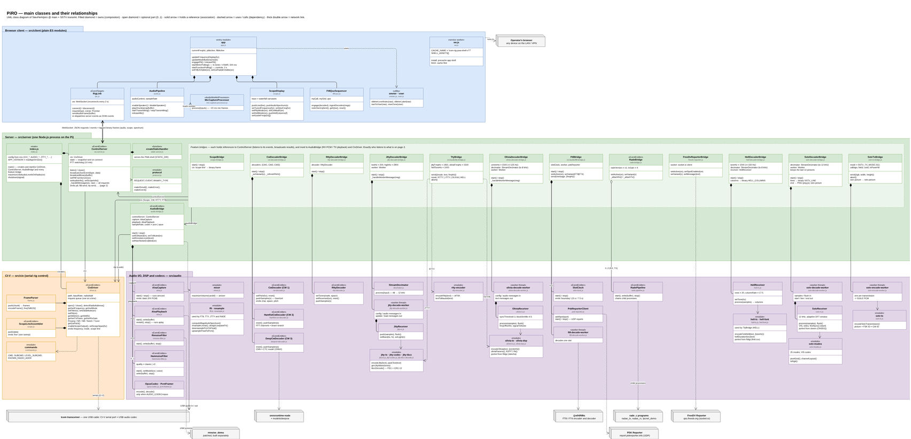

# PiRO

PiRO is a web app for remote control of an Icom transceiver. It runs as one
Node.js service on a Raspberry Pi (or any small Linux machine) that is
connected to the radio by USB. You open it in a browser on your network and
get frequency, mode and PTT control, RX/TX audio, a spectrum scope and
waterfall, and a set of digital-mode and noise-reduction tools. It needs no
Hamlib, no separate audio server and no extra apps.


Written by VK3TR. Licensed AGPL-3.0-only (see
[Licence](#licence)).

**Current build: v87.** This is the version the app shows next to its title.
It is the `CACHE_NAME` number in `src/client/sw.js`, which goes up with every
change to the web app.

## Warning!
Note that it DOES NOT include any form of login or password - so don't present it to the big bad internet or some rando will start controlling your rig! Always put it behind a firewall or VPN.

## Credits
Several of the cooler features in this app are built on the work of others:
- FreeDV support = https://github.com/freedv/rade_c
- FT8/FT4 support = https://github.com/e04/ft8ts
- CW 2 decoder = https://github.com/dawsonjon/HamFist
- CW 3 decoder = https://github.com/e04/web-deep-cw-decoder
- HamNoise denoiser = https://github.com/e04/HamNoise
- RNnoise denoiser = https://jmvalin.ca/demo/rnnoise/
- JTTY support = Ported to JS from https://wsjtx.github.io/wsjtx/index.html
- Olivia support = Ported to JS from Pawel Jalocha's (SP9VRC) MFSK code in fldigi, https://github.com/w1hkj/fldigi
- Feld-Hell support = Ported to JS from fldigi's Feld-Hell modem and font, https://github.com/w1hkj/fldigi
- SSTV receiver = Ported to JS from slowrx by Oona Räisänen (OH2EIQ), https://github.com/windytan/slowrx
- WSPR support = Ported to JS from wsprd and wsprsim (K1JT, K9AN) in WSJT-X, https://wsjtx.github.io/wsjtx/index.html

## Features

- **Rig control** over CI-V: frequency, mode, band, filter, PTT, TX power,
  S-meter, SWR and more.
- **Audio** both ways in the browser, using the radio's built-in USB sound
  codec through ALSA.
- **Spectrum scope and waterfall** from the radio's CI-V scope data (opt-in).
- **A CW decoder** (DeepCW, a neural decoder) and an RTTY decoder.
- **RTTY, JTTY, Olivia and Feld-Hell**: one "TTY" button selects RTTY, then
  cycles through [JTTY](https://wsjt.sourceforge.io/) (WSJT-X's new text
  mode), [Olivia 8/250](https://en.wikipedia.org/wiki/Olivia_MFSK) (the
  robust MFSK keyboard mode) and
  [Feld-Hell](https://en.wikipedia.org/wiki/Hellschreiber) (text sent as a
  picture), all ported to JavaScript here and the last two compatible with
  fldigi. In all four, a text box and a Send button replace PTT; received
  text is decoded as it arrives, or for Feld-Hell painted in the scope and
  read from the picture as text. See
  [RTTY, JTTY, Olivia and Feld-Hell](#rtty-jtty-olivia-and-feld-hell).
- **SSTV**: receive pictures in 25 modes (Martin, Scottie, Robot, PD,
  Wraase, Pasokon), recognised automatically from their VIS header, drawn as
  they arrive and then slant-corrected, with a strip of recent pictures to
  view full size or save; and send a photo from the phone's camera or an
  image file, cropped and tagged with your callsign, followed by an FSK ID
  and a CW ID. See [SSTV](#sstv).
- **FT8**: band-activity decoding, manual TX, and a guided QSO sequence that
  suggests each reply (you still send every message yourself). Optional PSK
  Reporter spotting.
- **WSPR** (the third choice of the DIGI button, after FT8 and FT4): receive
  and transmit, with the decoder ported to JavaScript from WSJT-X's wsprd.
  Spots go to [wsprnet.org](https://www.wsprnet.org). It can also receive
  on its own when nobody is connected. See [WSPR](#wspr).
- **FreeDV RADE** digital voice, with optional reporting to the
  [FreeDV Reporter](https://qso.freedv.org) map.
- **A noise reducer for received audio**: "HamNoise" (a neural denoiser
  trained on HF signals). RNNoise is also supported but hidden for now.

PiRO is made for Icom radios with a USB CI-V port and USB audio codec. The
CI-V address table covers the IC-7300, IC-7610, IC-9700, IC-705, IC-7100,
IC-7850 and IC-7851, and `IC-7300` is the default model. Spectrum-scope
behaviour varies by radio and firmware (see `docs/civ-notes.md`).

## Contents

1. [What you need](#what-you-need)
2. [Installing PiRO](#installing-piro)
3. [Optional components](#optional-components) (RNNoise, HamNoise, DeepCW, FreeDV RADE)
4. [Running PiRO as a systemd service](#running-piro-as-a-systemd-service)
5. [Configuration reference](#configuration-reference)
6. [Updating](#updating)
7. [Troubleshooting](#troubleshooting)
8. [Hardware diagnostics](#hardware-diagnostics)
9. [Project layout](#project-layout) and the rest of the developer reference
10. [Licence](#licence)

## What you need

| | |
|---|---|
| Computer | A Raspberry Pi 3, 4, 5 or Zero 2 W, or any Linux machine. Use a **64-bit** OS: the CW 3 decoder needs `onnxruntime-node`, which has no 32-bit ARM build. |
| OS | Raspberry Pi OS or Debian 12 "Bookworm" or newer. Other distributions work if you adjust the package names. |
| Node.js | 18 or newer. 20 or 22 is recommended. |
| Radio | An Icom transceiver connected by USB. The one cable gives a CI-V serial port and, on most models, a USB audio codec. |
| System packages | `alsa-utils` (audio), `git`. `build-essential` and `python3` are only needed if `npm install` has to compile the serial-port module itself. |
| Accurate clock | FT8 works in UTC 15-second slots, so the clock must be right. Raspberry Pi OS runs `systemd-timesyncd` by default. A Pi has no battery clock, so it needs the network at boot. |

## Installing PiRO

These steps take a fresh Raspberry Pi OS or Debian install as far as the app
running in a browser. `docs/install-debian.md` has the same steps with more
explanation.

**1. Update the system and install the packages.**

```bash
sudo apt update && sudo apt full-upgrade -y
sudo apt install -y git alsa-utils build-essential python3
```

**2. Install Node.js 18 or newer.** Debian's own package is often too old.
NodeSource gives a current version on both ARM and x86:

```bash
curl -fsSL https://deb.nodesource.com/setup_22.x | sudo -E bash -
sudo apt install -y nodejs
node --version      # must print v18 or higher
```

**3. Get PiRO and install its Node dependencies.**

```bash
git clone https://github.com/StevPem/piro.git ~/PiRO
cd ~/PiRO
npm install
npm test            # optional: runs the unit tests, no radio needed
```

**4. Let your user open the serial port and audio device.** Log out and back
in afterwards. (The systemd service in the next section does not need this,
because it adds the groups itself. You need it to run PiRO by hand.)

```bash
sudo usermod -a -G dialout,audio $USER
```

**5. Set up the radio.** In the radio's menu:

- Note the **CI-V USB Baud Rate**. PiRO's `CIV_BAUD_RATE` must match it. The
  default is 19200. Scope use usually needs 115200.
- Turn **CI-V Transceive** ON.
- Note the **CI-V Address** (0x94 is the IC-7300 factory default).

**6. Connect the radio and find its devices.**

```bash
ls /dev/ttyUSB* /dev/ttyACM*     # CI-V serial port, usually /dev/ttyUSB0
arecord -l                       # the radio's USB audio codec, e.g. "card 1: CODEC"
```

The audio device name for PiRO is `plughw:<card name>,0`, for example
`plughw:CODEC,0`.

**7. Start it.**

```bash
CIV_SERIAL_PATH=/dev/ttyUSB0 \
CIV_RADIO_MODEL=IC-7300 \
CIV_BAUD_RATE=19200 \
AUDIO_RX_DEVICE=plughw:CODEC,0 \
npm start
```

**8. Open `http://<pi-hostname-or-ip>:8080`** in a browser on the same
network. You should see the frequency display filled in and the status light
showing "Connected". Press Ctrl+C to stop it, then continue to
[Running PiRO as a systemd service](#running-piro-as-a-systemd-service) to
make it start at boot.

Leave out `AUDIO_RX_DEVICE` if you only want CI-V control. Audio, and the
decoders that use it, are then switched off.

**Microphone access from other devices.** Browsers only allow the microphone
on HTTPS pages (or `localhost`). To transmit from a phone or laptop, serve
PiRO over HTTPS with `TLS_CERT_PATH` and `TLS_KEY_PATH`. For a quick
self-signed certificate:

```bash
sudo mkdir -p /etc/piro
sudo openssl req -x509 -newkey rsa:2048 -keyout /etc/piro/key.pem -out /etc/piro/cert.pem \
  -days 825 -nodes -subj "/CN=$(hostname).local"
sudo chown $USER /etc/piro/key.pem /etc/piro/cert.pem && sudo chmod 600 /etc/piro/key.pem   # the service runs as you
```

Browsers show a warning for self-signed certificates the first time. See
`docs/pwa-notes.md` for alternatives (mkcert, a reverse proxy) and for
installing PiRO to a home screen.

## Optional components

PiRO works with just the steps above. Each feature in this section needs
something extra, and each one switches itself off cleanly (the button does
nothing and an error is shown) if its part is missing.

| Feature | What it needs | Where |
|---|---|---|
| CW decoders, RTTY, FT8, scope, "HamNoise" button | Nothing extra: they are bundled and installed by `npm install` | |
| "CW 3" decoder (DeepCW) | The bundled model and `onnxruntime-node` (installed by `npm install`) | [DeepCW](#deepcw-cw-3-decoder) |
| "RNN" button (hidden for now) | A patched `rnnoise_demo` that you build | [RNNoise](#rnnoise-rnn-button) |
| FreeDV RADE mode | `rade_c` built and installed | [FreeDV RADE](#freedv-rade) |

### RNNoise ("RNN" button)

**Hidden for now.** The RNN button is not shown in the app (since v84);
the server's RNNoise support is unchanged. To show it again, set
`RNNOISE_IN_UI` to `true` near the top of the RNN section in
`src/client/app.js`. The rest of this section describes it when shown.

[RNNoise](https://github.com/xiph/rnnoise) is a small neural network that
removes noise from speech. PiRO runs RNNoise's example program,
`rnnoise_demo`, as a background process and sends the received audio through
it. It is not installed by `npm install`, and **PiRO needs a modified copy of
`rnnoise_demo`**.

**Why it is modified.** Stock `rnnoise_demo` always writes fully denoised
audio. On weak HF signals that tends to mute the signal along with the noise.
The patched copy in [`third_party/rnnoise/rnnoise_demo.c`](third_party/rnnoise/rnnoise_demo.c)
takes an optional third argument, `wet`, and writes
`wet × denoised + (1 − wet) × original`. PiRO's "RNN" button steps through
several `wet` levels (by default 25%, 50%, 75% and 100%), so you can choose how
hard to filter. With `wet` left out the patched program behaves exactly like
stock RNNoise. PiRO always passes `wet`, so an unpatched build will not work.

**Build and install it** (a Pi 4 takes a few minutes):

```bash
sudo apt install -y build-essential autoconf automake libtool pkg-config curl
git clone https://github.com/xiph/rnnoise.git ~/rnnoise
cd ~/rnnoise
cp ~/PiRO/third_party/rnnoise/rnnoise_demo.c examples/rnnoise_demo.c   # the patch
./autogen.sh          # this also downloads RNNoise's trained model
./configure
make
sudo install -m 755 examples/rnnoise_demo /usr/local/bin/rnnoise_demo
```

`autogen.sh` downloads the model file from the RNNoise project, so the Pi
needs internet access for that step. The patched file was written against
RNNoise's current example, which calls `rnnoise_create(NULL)` to use the built-in
model. If a future RNNoise release changes `examples/rnnoise_demo.c`
substantially, re-apply the small change by hand: add the optional `wet`
argument and the blend line shown in the patched file.

**Check it.** This should create `/tmp/out.raw`, the same size as the input
minus one frame, with no error:

```bash
head -c 960000 /dev/zero > /tmp/in.raw     # 10 s of silence, 48 kHz 16-bit mono
rnnoise_demo /tmp/in.raw /tmp/out.raw 0.5 && ls -l /tmp/out.raw
```

**Tell PiRO where it is.** If it is on the `PATH` (`/usr/local/bin` is, even
under systemd) you need nothing. Otherwise set `RNNOISE_BIN=/full/path`. To
change the blend levels set `RNNOISE_WET`, a comma-separated list such as
`RNNOISE_WET=0.3,0.6,1.0`. The number of values sets the number of button
levels.

RNNoise only changes the audio you hear in the browser. The CW, RTTY, FT8
and FreeDV decoders always read the raw audio. It requires
`AUDIO_RX_DEVICE`.

### HamNoise ("HamNoise" button)

[HamNoise](https://github.com/e04/HamNoise) is a neural denoiser trained on HF
signals, with separate CW and voice models. Its WebAssembly models are
bundled in `models/hamnoise/`, so there is nothing to install. PiRO picks the
CW or voice model to match the radio's mode. It is switched on with the
"HamNoise" button after "NR" (or under "RNN" when that is shown; the two are
mutually exclusive).

HamNoise has two model generations. PiRO defaults to `classic`, which is light
enough for a Raspberry Pi. HamNoise's own newer `v2` models use roughly 36 to
53% of real time on a fast PC, and a Pi cannot keep up with them: the server
pins at 100% CPU. Set `HAMNOISE_QUALITY=v2` only on hardware that you have
tested.

In the author's testing, HamNoise helps on moderate signals (around S4 and up) where
RNNoise, which was trained on general speech noise rather than HF noise, is
more likely to mute them.

### DeepCW ("CW 3" decoder)

The model is bundled in `models/deepcw/` and runs in Node through
`onnxruntime-node`, which `npm install` fetches. It needs a 64-bit OS on a Pi.
If `onnxruntime-node` cannot load, the "CW 3" decoder is unavailable, and
since v84 that is the only CW decoder the app shows. The other two still
work: show them again with `CW_DECODERS_IN_UI` (see the CW section).

### FreeDV RADE

FreeDV mode needs the compiled tools from
[rade_c](https://github.com/freedv/rade_c): `radae_tx`, `radae_rx` and
`lpcnet_demo`, plus `librade.so`. Follow rade_c's own README to build it (it
uses CMake), then install the three programs and the shared library where
PiRO can find them:

```bash
cd ~/rade_c      # wherever you built it
find . \( -name radae_tx -o -name radae_rx -o -name lpcnet_demo -o -name 'librade.so*' \) -type f   # locate the build outputs
sudo install -m 755 <path>/radae_tx <path>/radae_rx <path>/lpcnet_demo /usr/local/bin/
sudo cp -a <path>/librade.so* /usr/local/lib/ && sudo ldconfig
```

PiRO finds the tools through the `PATH`, or through `RADE_TX_BIN`,
`RADE_RX_BIN` and `LPCNET_DEMO_BIN`. It also uses `stdbuf` from GNU coreutils,
which is already present on Debian and Raspberry Pi OS. `docs/ui-notes.md`
("The RADE codec bridge") describes the pipeline, and `RADE_TX_GAIN` (default
`4`) sets the TX drive. Adjust it by ear and by your radio's power meter or ALC
if the transmit level seems low or distorted. RADE is installed separately,
and nothing else in PiRO needs it.

## Running PiRO as a systemd service

A service starts PiRO at boot, restarts it if it stops, and keeps its log in
the journal. Two files in [`deploy/`](deploy/) do the work: `piro.service` (the
unit) and `piro.env.example` (all your settings).

**1. Put your settings in `/etc/piro/piro.env`.**

```bash
cd ~/PiRO
sudo install -D -m 644 deploy/piro.env.example /etc/piro/piro.env
sudo nano /etc/piro/piro.env      # set CIV_SERIAL_PATH, CIV_RADIO_MODEL, CIV_BAUD_RATE,
                                  # AUDIO_RX_DEVICE, STATION_CALLSIGN, ... and save
```

**2. Install the unit.** This fills in your username, the PiRO folder and the
path to Node:

```bash
sed -e "s|@USER@|$USER|" -e "s|@DIR@|$PWD|" -e "s|@NODE@|$(command -v node)|" \
  deploy/piro.service | sudo tee /etc/systemd/system/piro.service > /dev/null
```

The unit runs PiRO as your user, adds the `dialout` and `audio` groups for it,
and reads `/etc/piro/piro.env`.

**3. Enable and start it.**

```bash
sudo systemctl daemon-reload
sudo systemctl enable --now piro
systemctl status piro               # should say "active (running)"
journalctl -u piro -f               # live log; Ctrl+C to leave
```

**Everyday commands.**

```bash
sudo systemctl restart piro         # after editing /etc/piro/piro.env
sudo systemctl stop piro            # frees the serial port (only one program can hold it)
sudo systemctl disable piro         # stop it starting at boot
```

**Notes.**

- Only one program can use the CI-V serial port at a time. Stop the service
  before running a manual diagnostic script or another CAT program.
- Under systemd the `PATH` is minimal but includes `/usr/local/bin`, which is
  where the instructions above put `rnnoise_demo` and the RADE tools. If you
  installed them elsewhere, set `RNNOISE_BIN` and the `RADE_*_BIN` variables
  to full paths in `/etc/piro/piro.env`.
- USB devices can appear a moment after boot. If the radio is switched on
  later than the Pi, `Restart=on-failure` brings PiRO back up when it exits.
  For a device name that never changes, write a udev rule for the radio's
  serial number and point `CIV_SERIAL_PATH` at it.
- If you already run an older install under another unit name (for example
  `icom-rig-pwa`), keep using that name in the commands above, or disable it
  and install this one. Do not run two services on the same port.

## Configuration reference

All settings are environment variables. For the systemd service they go in
`/etc/piro/piro.env`. A line that is missing means the default shown.

| Variable | Default | What it does |
|---|---|---|
| `CIV_SERIAL_PATH` | `/dev/ttyUSB0` | The radio's CI-V serial port. |
| `CIV_RADIO_MODEL` | none | Radio model, such as `IC-7300`. Picks the CI-V address. |
| `CIV_BAUD_RATE` | `19200` | Must equal the radio's "CI-V USB Baud Rate" menu setting. |
| `CIV_SCOPE_ENABLED` | off | `true` turns on the spectrum scope and waterfall. |
| `CIV_MAXIMIZE_USB_LEVELS` | on | At start-up, sets the radio's USB audio levels to maximum. `0` or `false` leaves them alone. |
| `WS_PORT` | `8080` | Port for the web app and its WebSocket. |
| `AUDIO_RX_DEVICE` | none | ALSA capture device, such as `plughw:CODEC,0`. Audio and all decoders are off without it. |
| `AUDIO_TX_DEVICE` | same as RX | ALSA playback device for transmit audio. |
| `AUDIO_SAMPLE_RATE` | `48000` | Audio sample rate. |
| `AUDIO_CHANNELS` | `1` | Number of audio channels. |
| `AUDIO_CODEC` | `pcm` | `pcm` or `opus`. The shipped web app uses `pcm`. |
| `SCREEN_TITLE` | `SPARC PiRO` | Title shown in the browser tab and on the page. |
| `JTTY_TX_FREQ_HZ` | `1450` | Audio frequency of JTTY's lowest tone, in Hz. The signal fills about 94 Hz above it. |
| `JTTY_RX_LOW_HZ`, `JTTY_RX_HIGH_HZ` | `200`, `2900` | Audio range, in Hz, searched for JTTY signals. The default is the whole range the decoder supports. Two extra fixed channels at 1350 and 1650 Hz (±150 Hz) are always searched as well. A narrower range saves a little CPU. |
| `JTTY_RX_QUALITY` | `economy` | JTTY decoder effort. `economy` uses about 40% of `full`'s CPU and decoded nearly as many weak signals in testing. `light` is in between, `full` matches WSJT-X's search exactly, and `auto` runs `full` but drops to `economy` when the Pi falls behind. |
| `OLIVIA_FREQ_HZ` | `1500` | Olivia's default audio centre frequency, in Hz, for sending and receiving, until it is changed in the UI. The signal is 250 Hz wide; the receiver searches 125 Hz either side. |
| `OLIVIA_SQUELCH` | on | `off` turns off PiRO's filtering of junk characters and decodes exactly as fldigi does with its squelch off. See [Olivia](#rtty-jtty-olivia-and-feld-hell). |
| `SSTV_SAVE_DIR` | none | If set, every received SSTV picture is also saved in this folder as a PNG (`YYYYMMDD-HHMMSSz-<mode>.png`, UTC). |
| `SSTV_TX_MODE` | `S1` | SSTV transmit mode: `S1` (Scottie 1), or any mode id the receiver knows (`M1`, `M2`, `S2`, `SDX`, `R36`, `R72`, `PD90`, `PD120`, `PD180`, ...; see `src/audio/sstv-modes.js`). Read at startup. |
| `SSTV_TX_POWER_W` | none | TX power in watts while sending SSTV (put back afterwards). Unset leaves the power alone. |
| `SSTV_FSK_ID`, `SSTV_CW_ID` | on | `off` leaves out the FSK ID or the CW ID sent after each SSTV picture. Both use `STATION_CALLSIGN`. |
| `HELL_TONE_HZ` | `1000` | Feld-Hell's default audio tone, in Hz, for sending and receiving, until it is changed in the UI. The band frequencies the client tunes to assume the signal is at this tone. |
| `STATION_CALLSIGN`, `STATION_GRID` | none | Your callsign and Maidenhead grid. They set the FT8 default message and guided QSO, the FreeDV Reporter report, and WSPR's callsign (WSPR transmits only a plain call of up to 6 characters). |
| `WSPR_GRID` | `STATION_GRID` | The Maidenhead grid WSPR sends (the first 4 characters) and reports to wsprnet.org (4 or 6 characters, such as `QF22` or `QF22LB`). |
| `WSPR_UPLOAD` | on | `off` stops WSPR spots going to wsprnet.org. Uploading also needs `STATION_CALLSIGN` and a grid. |
| `WSPR_UNATTENDED` | off | `on` makes WSPR receive by itself 10 minutes after the last browser leaves: the radio goes to the WSPR frequency of its band (USB, DATA on), and goes back to how it was when a browser connects. It never transmits then. See [WSPR](#wspr). |
| `TLS_CERT_PATH`, `TLS_KEY_PATH` | none | Set both to serve HTTPS and WSS. Needed for the microphone from other devices. |
| `SOURCE_CODE_URL` | none | Link shown in the page footer. The AGPL asks you to offer the source to people who use your instance (see [Licence](#licence)). |
| `STATIC_DIR` | `src/client` | Folder the web app is served from. |
| `RNNOISE_BIN` | `rnnoise_demo` | Path to the patched `rnnoise_demo`. |
| `RNNOISE_WET` | `0.25,0.5,0.75,1.0` | Blend ratio for each level of the "RNN" button. |
| `HAMNOISE_QUALITY` | `classic` | `classic` or `v2`. See [HamNoise](#hamnoise-hamnoise-button). |
| `RADE_TX_BIN`, `RADE_RX_BIN`, `LPCNET_DEMO_BIN` | `radae_tx`, `radae_rx`, `lpcnet_demo` | Locations of the FreeDV RADE programs. |
| `RADE_VERSION` | `v1` | `v1` (stable) or `v2` (under development; both ends must match). |
| `RADE_TX_GAIN` | `4` | Transmit drive multiplier for RADE. |
| `FREEDV_REPORTER_ENABLED` | on | `0` or `false` stops any reporting to the FreeDV Reporter. Reporting also needs the "FDV Spot" box ticked in the UI. |
| `FREEDV_REPORTER_HOST` | public service | Only for testing against your own Reporter server. |

`CIV_SCOPE_ENABLED` also accepts `1`. The reasoning behind the less obvious
defaults (`HAMNOISE_QUALITY`, `RADE_TX_GAIN`, `RADE_VERSION`,
`CIV_MAXIMIZE_USB_LEVELS`) is in `docs/ui-notes.md` and
`docs/civ-notes.md`.

## Updating

```bash
cd ~/PiRO
git pull
npm install
sudo systemctl restart piro
```

The web app caches itself in the browser through a service worker. That cache
is renamed (the version number in `src/client/sw.js`) whenever the client
files change, so a normal refresh picks up an update. If you edit the client
files yourself, bump that version number too. If a page still looks old, do
one hard refresh (Ctrl+Shift+R, or Cmd+Shift+R on a Mac).

## Troubleshooting

- **Permission denied on the serial port.** Running by hand: add yourself to
  `dialout`, then log out and in. Under systemd the unit adds the group, so
  check `CIV_SERIAL_PATH` instead.
- **`npm install` fails with `node-gyp` or compiler errors.** Install
  `build-essential` and `python3`, and check that Node is version 18 or newer.
- **Every CI-V command times out.** The baud rate must match the radio's menu
  setting exactly, CI-V Transceive must be on, and nothing else (another CAT
  program, or a second PiRO) may hold the port.
- **No audio devices.** Install `alsa-utils` and check `arecord -l` shows the
  radio's codec. Some radios use a second USB cable for audio.
- **A noise-reduction button does nothing.** Look at `journalctl -u piro`. For
  "RNN", `rnnoise_demo` is probably not on the `PATH`, or is the unpatched
  build. Re-do the check in [RNNoise](#rnnoise-rnn-button).
- **The server runs at 100% CPU after turning HamNoise on.** Make sure
  `HAMNOISE_QUALITY` is not set to `v2` on a Raspberry Pi.
- **A digital transmission (FT8, RTTY, JTTY, Olivia, Feld-Hell, SSTV) keys
  the radio but shows no power.** The radio's display should read USB-D or
  LSB-D while it transmits; PiRO turns DATA mode on with CI-V `1A 06`
  (before v78 it sent the wrong command, so DATA mode never came on). Then
  check on the radio: Menu > Set > Connectors > MOD Input > **DATA MOD**
  must be **USB**, and USB MOD Level not 0. If it only happens sometimes,
  update to v80 or later: PTT used to follow the DATA mode command so
  closely that the radio could transmit from the microphone instead. PiRO
  now confirms DATA mode, and waits for it to take, before keying. A
  warning saying DATA mode was turned off during a transmission means
  something changed the radio's mode while it was sending.
- **FT8 or WSPR decodes nothing or at the wrong times.** Check the system
  clock with `timedatectl`. It must show "System clock synchronized: yes".
- **WSPR spots don't reach wsprnet.org.** The WSPR panel says whether the
  last upload worked. Uploading needs `STATION_CALLSIGN`, `WSPR_GRID` (or
  `STATION_GRID`) and internet access from the Pi (to `wsprnet.org`, port
  80), and must not be turned off with `WSPR_UPLOAD=off`.
- **The WSPR Transmit box can't be ticked.** Its tooltip says why: usually
  `STATION_CALLSIGN` or the grid is not set, or the callsign has a `/`.
- **The microphone is blocked in the browser.** Use HTTPS (see
  [Installing PiRO](#installing-piro)).

## Hardware diagnostics

The `test/manual-*.js` scripts talk to a real radio. Stop the service first,
because they need the serial port. None of them transmits.

```bash
node test/manual-civ-test.js /dev/ttyUSB0            # basic CI-V check (optionally add the address: 0x94)
node test/manual-scope-test.js /dev/ttyUSB0          # does your radio deliver scope data? (may need CIV_BAUD_RATE=115200)
node test/manual-scope-span-diagnostics.js /dev/ttyUSB0   # scope span slider rejected ("Radio rejected request")
node test/manual-smeter-diagnostics.js /dev/ttyUSB0       # S-meter shows wrong values; prints the raw reply bytes
node test/manual-txpower-diagnostics.js /dev/ttyUSB0      # TX power setting rejected (NG)
node test/manual-ws-test.js ws://<pi-hostname-or-ip>:8080 # talk to a running server's WebSocket
```

If you open an issue about one of these, include the script's full output and
what the radio's front panel showed. `docs/civ-notes.md` explains the common
causes.

## Project layout

[`docs/architecture.drawio`](docs/architecture.drawio) is a UML diagram of the
main classes and how they connect: browser client, server, feature bridges,
CI-V and audio. Its second page lists which events each server part listens to
and sends. Open it in [draw.io](https://app.diagrams.net/) or the draw.io
desktop app. [`docs/architecture.png`](docs/architecture.png) is a preview of the
first page.

[](docs/architecture.png)

```
src/
  civ/            CI-V driver: framing, BCD encoding, rig control,
                   spectrum scope decoding (all phases 1 & 6 — done)
  audio/          ALSA capture/playback, PCM framing, Opus codec (phase 3 — done);
                   also FT8 support: slot-clock (UTC 15s boundaries),
                   resampler (48k<->12k with anti-aliasing), the RX/TX
                   bridge, and its decode worker-thread — see docs/ui-notes.md;
                   RTTY (rtty-decoder.js, rtty-encoder.js), Olivia
                   (olivia-dsp.js, olivia-tx.js, olivia-rx.js,
                   olivia-decode-worker.js), Feld-Hell (hell-font.js,
                   hell-tx.js, hell-rx.js, fed by
                   server/hell-decoder-bridge.js), SSTV (sstv-modes.js,
                   sstv-rx.js, sstv-tx.js, sstv-decode-worker.js,
                   sstv-encode-worker.js, with server/sstv-decoder-bridge.js,
                   server/sstv-tx-bridge.js and server/png.js) and JTTY
                   (jtty-codec.js, jtty-tx.js, jtty-rx.js, jtty-tbcc-decode.js,
                   decimator.js, jtty-decode-worker.js); transmit is played
                   out by tty-bridge.js and receive is fed by
                   server/jtty-decoder-bridge.js;
                   WSPR (wspr-codec.js, wspr-rx.js, wspr-decode-worker.js,
                   with server/wspr-bridge.js and server/wsprnet.js)
  server/         WebSocket control layer (phase 2 — done), audio bridge
                   (phase 3 — done), scope bridge (phase 6 — done), static
                   file server (phase 4 — done), CW decoder bridge, FT8 protocol wiring
  client/         PWA app shell + rig control UI + spectrum scope display
                   (phases 4-6 — done): manifest, service worker, icons,
                   VFO/mode/band/PTT/S-meter controls, Web Audio RX/TX
                   pipeline, canvas spectrum trace + waterfall; also the
                   FT8 panel (band-activity table + manual composer),
                   FT8 mode's auto-tune-per-band logic, and the guided
                   FT8 QSO sequencer (ft8-qso.js)
test/
  frame.test.js           unit tests for CI-V framing/BCD, no hardware needed
  scope.test.js           unit tests for scope waveform decoding/reassembly,
                           synthetic frames, no hardware needed
  civ-driver.test.js      CivDriver integration tests against a fake serial
                           transport: request/reply matching (incl. the
                           subCmd disambiguation fix), scope-line wiring,
                           and scope span/mode/band-range commands
  data-mode-guard.test.js DATA mode confirmed before PTT (read back, retried,
                           settle time) and watched during a transmission
  ws-server.test.js       integration test for the control layer, stubbed
                           CivDriver, no hardware needed
  pcm-framer.test.js      unit tests for PCM frame accumulation
  opus-codec.test.js      real Opus encode/decode round-trip tests (WASM,
                           no hardware needed)
  mixer.test.js           unit tests for the ALSA mixer helper against an
                           injected fake execFile, no real amixer needed
  audio-bridge.test.js    integration test for the audio bridge, both pcm
                           (default) and opus codec modes, and the
                           startup volume-maximizing behavior: real
                           WebSocket, fake ALSA I/O, tagged binary frame format
  scope-bridge.test.js    integration test for the scope bridge: real
                           WebSocket, tagged binary frame encode/decode
                           round-trip, coexistence with audio frames
  static-server.test.js   static file server tests: content types, 404s,
                           path-traversal protection
  tls-server.test.js      confirms the server actually works over
                           HTTPS/WSS when TLS_CERT_PATH/TLS_KEY_PATH are set
  readme-version.test.js  checks the README's "Current build" number matches
                           CACHE_NAME in src/client/sw.js
  scope-display.test.mjs  unit tests for the client's waterfall color
                           mapping, tuning marker, click-to-tune math
                           (including the nearest-kHz snapping applied to
                           both the click and its hover-tooltip preview),
                           and 50kHz division ticks — genuinely executes
                           src/client/scope.js in Node (see docs/ui-notes.md)
  smeter.test.mjs         unit tests for the S-meter bucket logic —
                           genuinely executes src/client/smeter.js in Node
  vswr.test.mjs           unit tests for the VSWR raw-value conversion
                           and color zones — genuinely executes
                           src/client/vswr.js in Node, including a full
                           monotonicity sweep across all 256 raw values
  cw-decoder.test.js      unit tests for the CW decoder's DSP/timing —
                           Goertzel tone detection, morse lookup, full
                           end-to-end decoding of synthetic generated
                           audio (clean, noisy at fixed deterministic
                           seeds, and a sudden speed change), and the
                           self-calibrating auto pitch-detection feature
                           (locks onto the actual tone frequency from a
                           wrong starting pitch, ignores broadband noise,
                           can be disabled, and clears its state on
                           reset()) — including regression tests for the
                           real bugs found while building all of it
  hamfist-cw-decoder.test.js
                           unit tests for "CW2", the alternative FFT
                           multi-channel/beam-search CW decoder ported
                           from Jonathan Dawson's "Hamfist" project —
                           morse binary-tree lookup, dictionary
                           autocorrect/callsign validation, the element/
                           gap pre-filter, and full end-to-end decoding
                           of synthetic generated audio
  deepcw-decoder.test.js  unit tests for "CW3", the neural-network/CTC
                           CW decoder ported from e04/deepcw-engine —
                           bundled model/metadata load correctly, the
                           5-20s windowSeconds clamp, full end-to-end
                           decoding of a synthetic "PARIS" signal through
                           the real ONNX model, silence producing no
                           output, reset() clearing buffered state
                           without reloading the model, and API parity
                           (setPitch()/estimatedWpm) with CW1/CW2
  cw-decoder-bridge.test.js
                           unit tests for the server-side bridge's
                           mode/PTT-driven attach-to-PCM-stream logic,
                           its RIG_ERROR broadcast on a failed CW-pitch
                           read, and CW1/CW2/CW3 decoder-variant switching
                           (only the active decoder is fed PCM/
                           broadcasts, switching resets the newly-active
                           one, and CW3's 'error' event — e.g. a missing
                           onnxruntime-node binary — only broadcasts
                           AUDIO_ERROR while CW3 is the active variant),
                           using stub civ/controlServer/audioBridge/
                           decoder(s) — the DSP/model itself is covered
                           above, this only tests the wiring around it
  slot-clock.test.js      unit tests for FT8's UTC 15-second slot-boundary
                           arithmetic and the SlotClock event-firing
                           behavior, against an injected fake scheduler
  resample.test.js        unit tests for the FT8 resampler: FIR filter
                           design/application, linear resampling, and the
                           real RX/TX paths — including an anti-aliasing
                           regression (a would-alias 9kHz tone vs a
                           genuine in-band reference) and a full
                           12k->48k->12k round trip
  fft.test.js             unit tests for the from-scratch radix-2 FFT
                           behind the FT8 audio-spectrum display
                           (src/audio/fft.js): power-of-two validation,
                           DC-signal energy concentration, Hann window
                           shape, bin-width/peak-location correctness for
                           a known tone, short-input zero-padding, and
                           silent-input edge cases
  rtty-encoder.test.js    RTTY AFSK encoder: Baudot shifts, frame timing, and
                           round trips through the app's own RTTY decoder
                           (both polarities, 12/48 kHz, with noise)
  jtty.test.js            JTTY transmit port checked against WSJT-X's own
                           encoder: the spec's 34-bit vectors, 401 reference
                           messages (all exchange profiles), a reference
                           waveform; see third_party/jtty/README.md
  tty-bridge.test.js      RTTY/JTTY/Olivia/Feld-Hell transmit bridge (incl. the
                           RTTY LSB-D/USB-D AFSK switching): PTT, audio, status
                           events, abort, refusals, stub radio and ALSA
  cw-tx-bridge.test.js    CW text through the radio's keyer: speed and
                           break-in set and put back, 30-character pieces,
                           buffer-full retries, Stop, refusals, timing
  jtty-rx.test.js         JTTY receiver: list decoder, multi-frame messages,
                           two signals, noise, gaps, chunking, and WSJT-X's
                           own 10-frame sample recording
  olivia.test.js          Olivia port checked against a reference program built
                           from fldigi's own code (160 symbol sequences, a
                           waveform, 7 receive cases), plus noise, weak
                           signals, tuning range and the 48 kHz path; see
                           third_party/olivia/README.md
  olivia-decoder-bridge.test.js  Olivia receive bridge: arming, retuning, PTT,
                           decimation, spectrum, and a real worker end to end
  hell.test.js            Feld-Hell port checked against fldigi's own transmit
                           code (40 half-pixel sequences, a waveform), the
                           font, and the received picture clean, in noise,
                           off tune and via 48 kHz; see third_party/feldhell/README.md
  hell-decoder-bridge.test.js  Feld-Hell receive bridge: arming, retuning, PTT,
                           column frames, spectrum, the text read and sent
                           to a page that opens later
  hell-ocr.test.js        Feld-Hell text reader: clean, in noise (error-rate
                           limits), timing errors, off tune, no characters
                           from noise alone, a long stream
  wspr.test.js            WSPR coding against WSJT-X's wsprsim (symbols,
                           hash, message types 1-3) and the decoder on a
                           slot of audio (three signals, two 1.5 Hz apart,
                           start-time offsets, noise alone); see
                           third_party/wsjtx-wsprd/README.md
  wspr-bridge.test.js     WSPR bridge: a slot decoded by the real worker,
                           wsprnet.org form fields, power held at 5 W and
                           put back, transmit planning and the audio decoded
                           back, unattended receive and putting the radio back
  sstv.test.js            SSTV receiver: all 25 modes, whole pictures, PySSTV
                           audio, mistuning, clock error (slant), noise, no
                           false pictures, signal loss; see third_party/sstv/README.md
  sstv-decoder-bridge.test.js  SSTV receive bridge with the real worker: line
                           frames, PNG, kept pictures, saving, PTT
  sstv-tx-bridge.test.js  SSTV transmit: radio sequence (DATA MODE, power, PTT),
                           the audio decoded back (picture and FSK ID), Stop,
                           refusals
  jtty-decoder-bridge.test.js  JTTY receive bridge: arming, PTT, decimation,
                           backlog dropping, broadcasts
  manual-tty-ui.js        optional browser test of the TTY button, text box and
                           Send/Stop (needs Playwright and Chromium)
  ft8-bridge.test.js      integration tests for the FT8 RX/TX bridge:
                           attach/detach around active-state and PTT,
                           slot-boundary decode requests to a stub
                           worker, cross-slot callsign-memory carry-over,
                           the TX send/replace/error paths (including an
                           explicit freqHz targeting a specific TX
                           frequency instead of the bridge's own default,
                           and the {message, freqHz} 'ft8-send' payload
                           shape — see the guided QSO sequencer below),
                           and the audio-spectrum timer/framing/noise
                           -floor-relative color-scaling logic (via an
                           injected computeSpectrumFn stub — see
                           docs/ui-notes.md), using stub
                           civ/controlServer/audioBridge/slotClock/worker
                           — the actual DSP/codec is covered above, and
                           the real @e04/ft8ts calls are exercised
                           manually against real hardware, not unit-tested
  ft8-qso.test.mjs        unit tests for the guided FT8 QSO sequencer
                           (src/client/ft8-qso.js): parsing the standard
                           FT8 message set (CQ, reply-with-grid, signal
                           report, acknowledged report, RRR/RR73, 73),
                           formatReport()'s WSJT-X-style formatting/
                           clamping, defaultCqMessage(), row-highlight
                           matching (isRelatedToQso()), and the full
                           Ft8QsoSequencer state machine end to end in
                           both roles (replying to someone else's CQ, and
                           someone answering our own CQ — including
                           picking the strongest reply out of a pileup
                           and manually overriding that pick)
  manual-civ-test.js      manual smoke test against a real radio (CI-V only)
  manual-ws-test.js       manual smoke test against a running server, over
                           the network
  manual-scope-test.js    manual smoke test: confirms whether your specific
                           radio/firmware actually delivers scope data over
                           CI-V
  manual-scope-span-diagnostics.js
                           diagnostic tool: tries several candidate wire
                           encodings for the scope span-set command
                           directly against your hardware, using live
                           scope-line data as ground truth for whether
                           each one actually worked — for when the shipped
                           encoding (verified against a supplied worked
                           example, but still rejected on some hardware —
                           see docs/civ-notes.md) doesn't work for you
  manual-smeter-diagnostics.js
                           diagnostic tool: reads the S-meter repeatedly
                           and prints the raw reply bytes directly,
                           alongside every plausible interpretation of
                           them side by side — for when getSMeter()'s
                           byte-slicing guess (already wrong twice — see
                           docs/civ-notes.md) still doesn't match what
                           your radio's front panel shows
  manual-txpower-diagnostics.js
                           diagnostic tool: tries several candidate wire
                           encodings for the TX power set command
                           directly against your hardware — for when
                           setTxPower() is rejected (NG) on your radio.
                           Safe to run: setting the power level never
                           engages PTT or transmits anything by itself
docs/
  civ-notes.md    CI-V protocol implementation notes, incl. spectrum scope
                  byte layout and a real-world reliability caveat
  audio-notes.md  audio pipeline implementation notes (incl. PCM vs Opus)
  pwa-notes.md    PWA installability / HTTPS constraint notes
  ui-notes.md     client UI architecture, binary frame tagging, gesture/mic
                  lifecycle notes, testing boundary
  architecture.drawio  UML class diagram and event-wiring table (draw.io)
  architecture.png     preview of the class diagram
```


## Rig control UI

Opening `http://<pi>:8080` in a browser now gives you the real thing:
click-to-edit frequency (displayed grouped by thousands — "14.195.000",
not "14.195000" — for readability at a glance; the editable field itself
still takes/shows a plain decimal, e.g. "14.195000", so it stays a valid
number while you're typing) with -10kHz/-1kHz/+1kHz/+10kHz step buttons
alongside it, band quick-select (10 bands, 160m through 6m, the current
band highlighted the same way the current mode is) and mode buttons laid
out in fixed 2-row grids (see "Mode buttons" below), RX function
toggle buttons (Preamp, NR, NB, Notch, Filter — each cycles through its
states on click, e.g. "P.Amp Off" -> "P.Amp 1" -> "P.Amp 2", "Filter 1"
-> "Filter 2" -> "Filter 3") alongside them, a segmented S-meter (S0-S9
individually, +10dB through +60dB over S9 — see below) that switches to
showing VSWR with green/orange/red coloring while transmitting, antenna
tuner on/off and a separate one-shot Tune button plus a transmit power
dropdown (100/75/50/25/5W) below the S-meter, a fail-safe 10-minute
transmission cutoff enforced server-side (required for this style of
remote operation under the Australian amateur class licence — see
`docs/civ-notes.md`), push-to-talk (button or hold Space) that switches
to a two-button iambic CW paddle (Dot/Dash, adjustable WPM) whenever the
mode is CW, a scrolling CW decode ticker under the S-meter that
activates automatically alongside it (server-side Morse decoding from
the radio's own RX audio — see below), speaker/mic audio once you tap
"Speaker: off" to enable it
(browsers require a user gesture before audio can play), and — if
`CIV_SCOPE_ENABLED=true` and your radio cooperates (see `docs/civ-notes.md`) — a live spectrum trace and scrolling waterfall, colored with
Google's "Turbo" colormap (see `docs/ui-notes.md`), with a dashed tuning marker and
click-to-tune (click anywhere on either the trace or the waterfall to
retune to that frequency), plus a vertical RX gain slider (0-255,
default max) to its right. The Preamp/NR/NB/Notch/Filter
toggle buttons, the tuner on/off button, the transmit power dropdown,
and the RX gain slider are all actively polled to stay in
sync with the radio's actual state — including changes made from the
front panel, not just this UI — rather than just reflecting their own
last click; see `docs/ui-notes.md` for why and how. Multiple browser
tabs/devices can be connected at once and stay in sync — see
`docs/ui-notes.md` for the architecture and, importantly, the **testing
boundary**: server-side logic and pure client-side logic (waterfall
color mapping, tuning-marker and click-to-tune math, S-meter bucketing)
are covered by automated tests, but the actual Web Audio/microphone/PTT
flow and canvas rendering need manual verification in a real browser
against real hardware, since
this environment has no headless browser available to automate that.

The page also requests a **Screen Wake Lock** as soon as it loads, so a
phone's own screen timeout doesn't interrupt an operator mid-QSO while
they're just listening/watching rather than actively touching the
screen — re-requested automatically whenever the page becomes visible
again after being backgrounded (the browser force-releases the lock
while hidden). Requires a secure context (`https://`, same as the
service worker — see `docs/pwa-notes.md`) and a browser that implements
the API; degrades to the phone's normal screen-timeout behavior
otherwise, with no other effect on the app. See `docs/ui-notes.md`.

**Mode buttons.** Two rows of four: **SSB**, **AM**, **FM**, **CW** on top
(the radio's own voice and CW modes), and **TTY**, **DIGI**, **FreeDV**,
**SSTV** below (modes PiRO decodes or encodes itself). **SSB** is one button
for both sidebands: the first press picks the usual sideband for the band
(LSB below 10 MHz, USB from 10 MHz up), and pressing it again while in SSB
switches to the other. It reads **LSB** or **USB** while selected, and **SSB**
otherwise (including while a digital mode that runs on a sideband is
selected). **DIGI** is the FT8/FT4 button described next; it reads **FT8**
or **FT4** while selected.

An **FT8** chip (labelled **DIGI**) sits in the mode row itself (where the old RTTY chip used to sit,
styled identically to the real mode chips — see below for why it isn't
actually a hardware mode despite living there); selecting it puts the
radio on USB, auto-tunes to the current band's standard FT8 calling
frequency (re-tuning automatically on any subsequent band change too),
and swaps the PTT button/bandwidth control/scope-span row out for an
FT8 band-activity table and a manual message composer. Clicking a real
mode chip leaves FT8 mode again. See the **FT8** section below and
`docs/ui-notes.md` for the full design.

**The scope stays centered on the current frequency, with 50kHz division
markers below it and a "Scope Span" slider (2.5/5/10/25/50/100/250/500
kHz, default 100kHz) to control the width to each side of center** (a
"100kHz" span tuned to 7100kHz displays 7.000-7.200MHz — confirmed on
real hardware; see `docs/ui-notes.md`/`docs/civ-notes.md`). Mode is set
to Center once
when scope output is enabled (`ScopeBridge#start()`) — Center mode's
displayed center automatically tracks the VFO on the radio itself, so
this one-time setup keeps it centered through band clicks, direct entry,
scope click-to-tune, and even the front panel, with no per-change command
needed. Span is **not** set at server startup at all — the client
requests the default itself once connected, and the same slider changes
it on demand via the `setScopeSpan` WebSocket request; the slider's own
value is an index into the eight span options (equal positions along its
range), and every one of their values maps exactly onto one of the
radio's 8 fixed presets, no clamping needed. The 50kHz gridlines/tick
labels are computed by
`scopeDivisions()` and drawn/rendered fresh on every scope line — see
`docs/ui-notes.md`.

Getting the span command right took real back-and-forth, worth tracking
honestly since it took a genuine upgrade in source quality to finally
resolve. Several wire-format guesses were tried and confirmed wrong by
real hardware testing — including one that had checked out byte-for-byte
against a concrete worked example from an informal online source, which
still turned out wrong: it claimed the value was a single-byte *index*
(0-7) and that presets were labeled by their **half**-width, both
incorrect. The breakthrough was Icom's own official IC-7300 CI-V
reference manual (Section 19), whose own reference table explicitly
confirms the value is the span **directly in Hz** — settling a question
no prior source had actually answered unambiguously. The manual also
revealed a second, separate bug: scope mode-setting needed a 2-byte
payload, not the 1-byte one this project had been sending (which hadn't
been causing visible failures, just not matching spec). The exact byte
*position* of the span value within its 6-byte payload still isn't
independently hardware-confirmed the way frequency encoding is — PDF
extraction of the manual's own diagram is inherently lossy — so
`test/manual-scope-span-diagnostics.js` has been updated with the
manual-derived encoding as its primary candidate for final verification
against real hardware. See `docs/civ-notes.md` for the full history and
`docs/ui-notes.md` for the span slider.

**S-meter**: bucketed into 16 segments (S0 through S9 individually,
+10dB through +60dB over S9) using real calibration data — refined
twice now as better data became available: first an even-spacing
placeholder (no manufacturer table existed at the time; Icom's S-meter
is well-documented as non-linear/inconsistent across models/firmware),
then a supplied raw-value-range table that could only distinguish
"S1-S3" as one combined bucket, and now a power-curve-derived table
giving individual S1-S9 buckets, superseding that combined range
entirely. Just the bucketed label is shown (e.g. "S7") — an earlier
version also showed the raw value alongside it, dropped per explicit
request (see `docs/ui-notes.md`).

**VSWR while transmitting**: the same S-meter bar switches to showing
VSWR (green ≤1.5, orange >1.5–3, red >3, capped at 5) whenever PTT is
active, reverting back once released. `CivDriver#getSWR()` reuses the
S-meter's now-hardware-confirmed byte decode, since it lives under the
same CI-V command group and Icom's manual documents it in the identical
table style — a reasoned extension backed by clean matches against all
of the manual's own documented examples, but **not independently
confirmed against a real transmit into a known load** the way S-meter
itself now is. See `docs/civ-notes.md` for the full reasoning and
`src/client/vswr.js`/`test/vswr.test.mjs` for the raw-to-VSWR conversion.

**Receive filter (Filter 1/2/3)**: no standalone CI-V command exists for
this — it's the second byte of the existing mode-set command, so
`CivDriver#setFilter()` reads the current mode first and resends it
unchanged alongside the new filter byte, rather than risking an
accidental mode change.

**Transmit power (100/75/50/25/5W dropdown)**: `CivDriver#setTxPower()`
converts watts to the CI-V level's raw 0-255 range via a **simple linear
assumption** (100W rated max) — that part remains unverified. The byte
*encoding* itself, however, was tested on real hardware and found
wrong: the first attempt (standard BCD) got every write rejected
outright (NG), root-caused to an invalid byte value for higher
wattages, and fixed by reusing the packing already confirmed for the
S-meter. See `docs/civ-notes.md` for the full story, and
`test/manual-txpower-diagnostics.js` if it's still rejected on your
hardware (safe to run — it never engages PTT or transmits anything).

**RX gain (vertical slider, right of the scope)**: raw 0-255, no unit
conversion, defaulting to 255 (max). Applies the TX power lesson
immediately rather than repeating it — RF gain lives in the same CI-V
command group as TX power, so `CivDriver#setRxGain()` uses the same
byte packing from the start. Worth being precise about what that rests
on: it's an inference on top of an inference (TX power's fix for its own
NG rejection hasn't itself been hardware-confirmed yet), not something
independently verified for RX gain specifically. See `docs/civ-notes.md`.

**CW iambic paddle**: replaces the PTT button with Dot/Dash buttons
whenever the mode is CW. Real limitation worth stating plainly: there's
no CI-V primitive for timed keying, so every element goes through the
same PTT toggle used for voice, over the full WebSocket + serial round
trip — expect visibly less precise timing than a hardware keyer,
especially at higher WPM. Defaults to a conservative 15 WPM given that
latency. See `docs/ui-notes.md` for the full design, including a
defense-in-depth session timer that closes a real gap in the PTT
watchdog below (a stuck paddle producing continuous keying wouldn't
otherwise trip it, since each element's brief gap resets the server-side
timer).

**CW text**: above the Dot/Dash buttons in CW mode is a text box and
**Send**. Type a message (or use the CQ it starts with) and press Send or
Enter: PiRO hands the text to the radio's own CW keyer (CI-V command `17`),
which sends it at the speed in the **WPM** box (6–48 WPM on the radio's
keyer). Because the radio does the keying, the timing is exact at any
speed, unlike the paddle. For each message PiRO:

* checks that the radio is in CW or CW-R;
* sets the keyer to the WPM box's speed;
* turns semi break-in on if it was off (the radio only transmits CI-V CW
  with break-in on);
* gives the keyer the text 30 characters at a time, retrying while the
  radio's buffer is full;
* waits until the radio has finished transmitting, then puts the keyer
  speed and break-in back as they were.

Send turns into **Stop** while it goes out, which stops the radio's keyer
at once. Every browser sees the progress. Letters, digits and
`/ ? . , : ' ( ) = + " @ -` can be sent; `^` joins the next two letters
into one prosign (`^AR`, `^SK`), as on the radio's own keyer memories.
Anything else is left out, and the status line says what was dropped.
Messages are limited to 300 characters and under 9 minutes. PTT isn't used,
so the 10-minute PTT cut-off doesn't apply; the length limit stands in for
it. Not yet tested on air.

**PTT fail-safe (10-minute automatic cutoff)**: enforced server-side,
required for this style of remote operation under the Australian
amateur class licence (`Radiocommunications (Amateur Stations) Class
Licence 2023`, s.13(4)(b)). Deliberately not client-side — the server is
the persistent process, so a crashed browser tab or dropped network
connection while transmitting still gets caught, which is exactly the
scenario the rule exists to guard against. Normal CW keying never trips
it, since every PTT-off (including the natural gaps between keyed
elements) resets the timer — only a truly continuous, unbroken
transmission accumulates toward the limit. See `docs/civ-notes.md` for
the full design and the one known gap (not persisted across a server
restart) that's accepted rather than solved.

**CW decoder**: activates automatically whenever mode is CW, decoding
from the radio's own RX audio server-side (a hard dependency on
`AUDIO_RX_DEVICE` being configured — see below) and streaming text to a
scrolling ticker under the S-meter. Built and tuned against synthetic
generated audio, not assumed correct — four real bugs (a cold-start
silent-drop bug, a wrong-direction speed-adaptation bug, a genuine
noise-vs-speed-range tuning tradeoff, and a bug where any message
starting with a dash — including "CQ", the most common CW call there is
— had its very first character misread) were found and fixed this way;
see `docs/civ-notes.md` for the full account. Clicking to tune the scope
while in CW mode also sets the exact clicked frequency rather than
snapping to the nearest kHz, the same as RTTY mode, since a CW signal's
own bandwidth is too narrow for kHz-precision tuning to reliably land on
it. Worth being direct about realistic expectations: like any CW
decoder, weak or noisy signals degrade it, sometimes significantly —
this is a genuinely useful aid for clean-to-moderate signals, not a
guarantee of accurate copy in poor conditions, the same caveat that
applies to dedicated hardware/software CW decoders generally. The app
uses "CW3", the DeepCW decoder, and the mode chip just reads "CW". Two
other decoders are kept but hidden for now (since v84): to offer them
again, set `CW_DECODERS_IN_UI` in `src/client/app.js` to
`['CW1', 'CW2', 'CW3']`; the chip then reads "CW 1"/"CW 2"/"CW 3" and a
click while already in CW cycles CW1 -> CW2 -> CW3 -> CW1. "CW1" is the original decoder
described above, "CW2" is a from-scratch port of Jonathan Dawson's
"Hamfist" decoder (https://github.com/dawsonjon/HamFist): an FFT-based
design that decodes across several frequency channels at once (no pitch
calibration needed — whichever channel has the tone lights up on its
own), with histogram-based (rather than fixed-ratio) dot/dash/gap
classification and a Bayesian beam-search decode backed by a ~9800-word
autocorrect dictionary; and "CW3" is a neural-network decoder ported from
`e04/deepcw-engine` (https://github.com/e04/web-deep-cw-decoder): a small
CNN+CTC model run via `onnxruntime-node`, with no timing/classification
model at all. Unlike CW1/CW2, CW3 doesn't decode live character-by-
character — it batches 5-20 second audio windows through the model, so
its output arrives in bursts every several seconds rather than as each
element is keyed. It also depends on a native `onnxruntime-node` binary
for the host platform: prebuilt binaries cover 64-bit Raspberry Pi OS
(Pi 4/5, `linux-arm64`), but *not* 32-bit `armv7` (`linux-arm`); if no
matching binary is available, CW3's model fails to load and that failure
is surfaced as an error banner while CW3 is selected, rather than
silently decoding nothing. Bundling this model is also why the project as
a whole is now AGPL-3.0-only — see "Licence" below. See
`docs/ui-notes.md`'s "CW decoder" section, `src/audio/hamfist-cw-decoder.js`'s
and `src/audio/deepcw-decoder.js`'s own doc comments for the full
comparison.

**RTTY decoder**: activates automatically whenever mode is RTTY, decoding
Baudot/ITA2 from the radio's own RX audio server-side (same
`AUDIO_RX_DEVICE` dependency as the CW decoder) and streaming text to a
scrolling ticker under the S-meter, the same presentation as CW's own. The
RF scope also draws a second dashed marker while RTTY is active: a blue
dashed line 170Hz below the tuned-frequency marker (which stays its usual
green), marking the mark/space shift — trace-only, like the tuning marker
itself, not drawn into the waterfall. Clicking to tune the scope while in
RTTY mode also sets the exact clicked frequency rather than snapping to
the nearest kHz, since RTTY's tones are packed too closely together for a
1kHz snap to reliably land where intended. A "Reverse" checkbox next to
the ticker swaps which tone (mark/space) the decoder treats as which —
RTTY polarity genuinely isn't predictable from the radio's mode alone (it
depends on both stations' equipment), so a signal using the opposite
polarity from the decoder's assumption previously decoded nothing at all;
see `docs/ui-notes.md`'s "Real bug found" writeup for the full story.
Unchecked by default.

### RTTY, JTTY, Olivia and Feld-Hell

The mode row has one **TTY** button where the RTTY button used to be:

1. The first click selects the radio's RTTY mode, and the button now reads **RTTY**.
   Selecting RTTY also tunes to the middle of the band's digital-modes segment
   in the WIA band plan (e.g. 14.091 MHz on 20 m; see the table below), and band
   buttons then do the same.
2. The next click switches to **JTTY**, and the button reads **JTTY**.
   Entering JTTY also tunes to the standard JTTY dial frequency for the current
   band (e.g. 14.090 MHz on 20 m; the list is the WSJT-X 3.3 beta's and is marked
   preliminary), and band buttons then go to each band's JTTY frequency.
3. The next click switches to **Olivia** (Olivia 8/250), and the button reads
   **Olivia**. Entering Olivia tunes to the band's Olivia calling frequency
   (e.g. 14.0715 MHz dial on 20 m), and band buttons then go to each band's.
4. The next click switches to **Feld-Hell**, and the button reads
   **Feld-Hell**. Entering Feld-Hell tunes so a signal on the band's Feld-Hell
   frequency (e.g. 14.063 MHz on 20 m) comes out at the audio tone (dial
   14.062 MHz with the default 1000 Hz tone), and band buttons then go to
   each band's.
5. The next click goes back to **RTTY**, and so on round.
6. Picking any other mode (LSB, USB, AM, FM, CW, FT8, FreeDV) puts the button
   back to **TTY**.

While RTTY, JTTY, Olivia or Feld-Hell is selected, a text box and a **Send** button replace the
PTT button. Enter in the text box also sends. While a message is going out,
Send turns into **Stop**, which cuts the transmission short and releases PTT.
The Space bar does not key the microphone in these modes. The text box starts
with a CQ built from `STATION_CALLSIGN` (if set), and keeps whatever you
type when you switch between the modes.

**RTTY band frequencies.** RTTY has no calling frequencies, so PiRO starts
you in the middle of each band's narrowband digital segment from the WIA's
band plan (the WIA Technical Advisory Committee's
[HF digimodes paper](https://www.wia.org.au/members/bandplans/data/documents/TAC%20Band%20Plans%20-%20HF%20Digimodes%20170103.pdf)),
to tune around from. The radio's RTTY mode displays the mark frequency.

| Band | WIA digital segment (MHz) | PiRO tunes to (MHz) |
|---|---|---|
| 160 m | 1.800–1.810 | 1.805 |
| 80 m | 3.620–3.640 | 3.630 |
| 40 m | 7.040–7.060 | 7.050 |
| 30 m | 10.130–10.140 | 10.135 |
| 20 m | 14.070–14.112 | 14.091 |
| 17 m | 18.100–18.110 | 18.105 |
| 15 m | 21.070–21.125 | 21.0975 |
| 12 m | 24.920–24.930 | 24.925 |
| 10 m | 28.050–28.150 | 28.100 |

6 m has no segment in the paper, so its band button works as usual. The same
paper proposes moving 80 m to 3.570–3.600 MHz (where most of the world's
80 m RTTY is) and widening the 30, 17, 15, 12 and 10 m segments; the table is
`RTTY_FREQUENCIES` in `src/client/app.js` if the plan changes. Busy RTTY is
often elsewhere in the segment (on 20 m, 14.080–14.099), and keep clear of
the beacons at 14.100, 18.110, 21.150 and 24.930 MHz.

**RTTY** sends your text as audio-frequency-shift keying (AFSK): 45.45 baud,
170 Hz shift, with mark always the **higher** of the two RF frequencies, as
RTTY convention requires. The radio's own RTTY mode does not transmit audio
from USB (it keys FSK from its RTTY keying line, so on its own it would just
send a steady carrier). So when you press Send in RTTY, PiRO:

1. reads the frequency the radio shows in RTTY mode, which is the mark frequency;
2. switches to **LSB** with DATA MODE on below 10 MHz, or **USB** with DATA
   MODE on from 10 MHz up, and moves the dial so the mark lands exactly on
   that frequency;
3. keys PTT and plays the tones (on LSB, mark 2125 Hz and space 2295 Hz audio,
   dial 2125 Hz above the mark; on USB, mark 2295 Hz and space 2125 Hz audio,
   dial 2295 Hz below the mark; either way space ends up 170 Hz below mark);
4. puts the radio back in RTTY mode, with its filter, on the mark frequency.
   This also happens if you press Stop or something goes wrong.

The page keeps showing RTTY and the mark frequency throughout, and the status
line says which sideband was used. The "Reverse" tick-box swaps mark and space
for transmit as well as receive, and the radio's RTTY-R mode is kept reversed.
As with FT8, the IC-7300's DATA MOD setting must be USB for the audio to reach
the transmitter. Tested against PiRO's own decoder and a stub radio, not on air.

**JTTY** is a mode from WSJT-X 3.3 (beta): 4-tone Gaussian FSK at 31.25 baud,
no time slots, one to sixteen 1.9-second frames per message, with strong
error correction (a K=10 convolutional code and a CRC). Text is packed into
the fewest frames, so "CQ VK3TR CQ" takes one frame while free text takes
one frame per five characters. A message can be up to 80 characters. Selecting
JTTY puts the radio on USB with DATA MODE on, as FT8 does. Transmission starts
the moment you press Send, with the lowest tone at `JTTY_TX_FREQ_HZ` (1450 Hz
by default, so the signal sits around 1500 Hz). The **TX freq** box above the
text field sets the frequency for the next message.

**JTTY receive.** While JTTY is selected, a table under the composer lists
messages as they are decoded: UTC time, audio frequency, SNR and text. A line
shows in amber and grows frame by frame while the message is still arriving;
a lost frame shows as " ... ". The spectrum scope switches to the same 0-3 kHz
audio spectrum FT8 uses, with an amber marker at your transmit frequency;
click the spectrum, or tap a decoded line, to move that frequency onto a
station. Decoding happens on the Pi in a worker thread and
only runs while JTTY is selected and you are not transmitting. It searches
`JTTY_RX_LOW_HZ`..`JTTY_RX_HIGH_HZ` (by default the whole 200-2900 Hz
passband) plus two fixed channels around 1350 and 1650 Hz. The default `economy` effort keeps the load low on a Raspberry Pi 4;
see `JTTY_RX_QUALITY`.

The encoder and decoder are JavaScript ports of WSJT-X's; see
[`third_party/jtty/README.md`](third_party/jtty/README.md) for what was ported
and how both were checked against WSJT-X's own programs. The receiver is not
tested over the air, and, as with WSJT-X itself, noise can occasionally
produce a false decode.

**Olivia** is the 8-tone, 250 Hz-wide variant of
[Olivia MFSK](https://en.wikipedia.org/wiki/Olivia_MFSK), the most common
starting point on HF: 31.25 baud, each block of 64 symbols carrying three
characters with strong error correction, so text goes at about 1.5
characters a second and copies at around −14 dB S/N. It is compatible with
fldigi's Olivia 8/250. Selecting Olivia puts the radio on USB with DATA MODE on,
as JTTY does. The **Centre** box sets the audio centre frequency (1500 Hz by
default, `OLIVIA_FREQ_HZ`) used both for sending and for receiving; click the
spectrum to move it. Like fldigi, PiRO starts every transmission with the
short start tones at the band edges and ends it with stop tones. A message
can be up to 300 characters (about 3.5 minutes on air). Characters 128-255 are
sent with fldigi's 8-bit escape, and characters beyond that as ".".

**Olivia receive.** While Olivia is selected, the panel under the S-meter
shows received text as a running transcript, with your own transmissions
inline in amber, and a line giving the time, the S/N figure and how far the
signal is from the centre. The receiver searches 125 Hz either side of the
centre, so a station a little off frequency is still copied; **Tune to
signal** moves the centre onto it, so your reply goes out where that station
is. As with fldigi, text appears about four blocks (8 s) after it is sent,
because the receiver averages over several blocks before deciding.
Decoding runs on the Pi in a worker thread, only while Olivia is selected
and you are not transmitting.

PiRO filters out the junk characters fldigi prints with its squelch off, in
two ways. A block is only shown if its own S/N is strong enough, as well as
the averaged one, and blocks containing control codes that text never uses
are dropped. In testing that removed every false character from 1,000 s of
plain noise (fldigi printed 59 a minute) without losing any copy down to
−14 dB. A strong neighbouring Olivia signal just outside the search window
can still leave a stray character or two. Set `OLIVIA_SQUELCH=off` to get
fldigi's exact behaviour.

The Olivia modem is a JavaScript port of Pawel Jalocha's code in fldigi; see
[`third_party/olivia/README.md`](third_party/olivia/README.md) for what was
ported and how it was checked against a reference program built from
fldigi's own source. It has not yet been tested over the air.

**Feld-Hell** is the classic Hellschreiber mode: each character is drawn,
column by column, from a 7-dot-high font and sent by keying a single tone on
and off (17.5 columns a second, 122.5 baud, about 2.5 characters a second, a
signal some 350 Hz wide). There is no code to decode at the other end; the
receiver paints the tone as a picture and you read it, which is why
Feld-Hell copies through noise and fading that would garble a coded mode.
PiRO also reads the picture as text for you (see below).
Selecting Feld-Hell puts the radio on USB with DATA MODE on, as JTTY and
Olivia do. The **Tone** box sets the audio frequency (1000 Hz by default,
`HELL_TONE_HZ`), used both for sending and for receiving; click the spectrum
on a signal to move it there (to the nearest 10 Hz). Transmissions are sent
exactly as fldigi sends them, with its default font and 2 ms keying shape,
and begin and end with "...". A message can be up to 400 characters (under
three minutes); characters the font does not have are sent as a blank gap.

**Feld-Hell receive.** While Feld-Hell is selected, the scope's upper part
still shows the 0-3 kHz audio spectrum (with an amber marker at the tone),
but its waterfall becomes the received picture, scrolling in from the right
as it arrives. As in fldigi, each column is shown twice, one copy above the
other (the previous column under the current one): Feld-Hell has no synchronisation, so text drifts up or down the
picture, and this way a whole line of it is always in view. Text that slopes
means the other station's timing is slightly off; it is still readable.
The receiver listens about 150 Hz either side of the tone. It is cheap enough
to run on the Pi's main thread, and only runs while Feld-Hell is selected and
you are not transmitting.

**Feld-Hell text.** Below the picture, a **Feld-Hell text** panel shows what
PiRO reads from it. It matches the picture against the font fldigi (and
PiRO) send with, letter by letter, allowing for where each letter sits up or
down the picture and for slant, and prints what it reads about two seconds
behind the picture. Your own transmissions appear in amber, as in Olivia's
panel, and a browser opened later is sent the recent text. In tests through
PiRO's own transmitter and receiver, with random callsign-like text:

| Signal (S/N in 3 kHz) | 10 dB | 3 dB | 0 dB | −3 dB | −6 dB | −9 dB |
|---|---|---|---|---|---|---|
| Characters wrong | 0.6% | 0.3% | 1.3% | 5.5% | 33% | 95% |

Timing errors of ±0.1% (text sloping in the picture) make no difference.
To keep noise from being printed as letters, it waits for a run of good
matches before printing anything: no false characters were printed in five
minutes of noise alone. So on a weak signal it may print nothing, or only
part of it, while you can still read the picture. Trust the picture.

Limits:
* It only reads fldigi's default Feld-Hell font ("hell 12"). Another font,
  "wide" Hell (each column sent twice) or hand-sent Hell won't read.
* Several lower-case letters are drawn exactly like capitals in this font,
  so they read as capitals; the ones drawn differently (such as e and k)
  read as lower case.
* fldigi's opening "..." isn't printed: dots are too small to start the
  text, because noise fits them too easily. The closing "..." is.
* Deep fading loses the faded part, as it does for your eye.
* It costs a few percent of a Pi's CPU while Feld-Hell is selected. It has
  not yet been tested on real off-air signals.

The Feld-Hell modem is a JavaScript port of fldigi's; see
[`third_party/feldhell/README.md`](third_party/feldhell/README.md) for what was
ported and how the transmitter was checked against fldigi's own code. It has
not yet been tested over the air.

Transmit is refused if the radio is already transmitting. The usual PTT
watchdog (ten minutes) still applies.

### WSPR

WSPR is the third choice of the **DIGI** button: FT8, then FT4, then WSPR,
then FT8 again. It puts the radio on USB with DATA MODE on and tunes to the
band's WSPR frequency (for example 7.0386 MHz on 40 m and 14.0956 MHz on
20 m). Band buttons then go to that band's WSPR frequency. The WSPR signals
are 1400-1600 Hz up; the spectrum marks that window.

WSPR runs in 2-minute slots that start on even UTC minutes. PiRO decodes
every slot it isn't transmitting in. The decoder is WSJT-X's `wsprd`,
ported to JavaScript (`src/audio/wspr-rx.js`); see
`third_party/wsjtx-wsprd/README.md`. It runs in a worker thread and takes a
few seconds per slot. The spots are listed newest first (time, SNR, time
offset, frequency, callsign, grid, power in dBm; tap-and-hold a row for the
drift). Every browser sees the same list, and a page that opens later gets
the recent spots.

Spots go to wsprnet.org after each slot, the way WSJT-X sends them (a
"wsprstat" report when nothing was heard). This needs `STATION_CALLSIGN`
and `WSPR_GRID` (or `STATION_GRID`); `WSPR_UPLOAD=off` turns it off. The
panel shows whether the last upload worked.

While WSPR is on, the **Power** menu offers 1-5 W, and the radio is held at
5 W or less (checked again before each transmission). The power from before
is put back when you leave WSPR.

Tick **Transmit** to transmit too. About one slot in five is then picked at
random, never two in a row, as WSJT-X does with "Tx Pct 20"; the panel says
when the next one is. A transmission starts 1 s into its slot and lasts
110.6 s. It sends `STATION_CALLSIGN`, the first 4 characters of the grid and
the radio's power in dBm (1 W is 30, 2 W is 33, 3-5 W are 37). The transmit
audio frequency is 1500 Hz unless you change it (1410-1590 Hz, in the box
or by tapping the spectrum). WSPR transmits only a plain callsign of up to 6
characters, so not one with a `/`. Transmit stops when the last browser
leaves. Unticking Transmit, or leaving WSPR, stops a transmission straight
away. Not tested on air.

**Unattended receive** (`WSPR_UNATTENDED=on`, off by default): 10 minutes
after the last browser disconnects, PiRO tunes the radio to the WSPR
frequency of the band it is on (20 m if it isn't near one), on USB with
DATA on, and receives and uploads spots by itself. It never transmits then.
When a browser connects, it stops and puts the frequency, mode and DATA
mode back.

### SSTV

The **SSTV** button turns on SSTV (slow-scan television). It puts the radio
on the band's usual sideband (LSB below 10 MHz, USB above; DATA MODE only
while sending) and tunes to the band's SSTV frequency. Band buttons then do
the same:

| Band | Frequency (MHz) | Sideband |
|---|---|---|
| 40 m | 7.171 | LSB |
| 20 m | 14.230 | USB |
| 15 m | 21.340 | USB |
| 10 m | 28.680 | USB |
| 6 m | 50.950 | USB |

The usual 160 m (1.890 MHz) and 80 m (3.730 and 3.845 MHz) frequencies are
outside the Australian allocations, so on those bands, and on 30, 17 and
12 m, which have no usual SSTV frequency, the band buttons tune as normal.
The table is `SSTV_FREQUENCIES` in `src/client/app.js`.

The PTT button stays the ordinary voice PTT (for talking about the
pictures); pictures are sent with the panel's Send button (below). The
scope shows the 0-3 kHz audio spectrum with faint lines at 1200 Hz (sync),
1500 Hz (black) and 2300 Hz (white) to tune by.

The receiver waits for the VIS header that starts every SSTV picture, which
names its mode, and handles 25 modes: Martin M1-M4, Scottie S1, S2 and DX,
Robot 36, 72, 24 and the black-and-white 8, 12 and 24, PD 50, 90, 120,
160, 180, 240 and 290, Wraase SC-2 120 and 180, and Pasokon P3, P5 and P7.
It measures how far the signal is from the standard tones from the header
(so it copies a station up to about 150 Hz off), and its frequency
measurement gets more averaging as the signal gets noisier. The picture
panel under the S-meter fills in line by line as the picture arrives, with
the mode, line count and offset above it. When the picture ends, the
receiver finds the sync pulses' slope, which is how far the other station's
sound card clock is off, and redraws the picture straight. It then joins
the strip of recent pictures (the last 12, kept by the server, so another
browser or a reload sees them too).

* **Stop** ends the picture now and keeps what has arrived. A picture also
  ends by itself if the sync pulses stop for 12 lines (the signal has gone),
  and when you transmit.
* **Save** downloads the picture shown as a PNG, at its own resolution.
* Tap the picture to open it full size (pinch to zoom; tap again to close).
  Thumbnails show older pictures.
* Set `SSTV_SAVE_DIR` to have the server save every picture there as well.

Picture sizes are 320 × 256 for Martin, Scottie, Wraase and PD 50/90,
320 × 240 for Robot, 512 × 400 for PD 160 and 640 × 496 for PD 120/180/240
and Pasokon (800 × 616 for PD 290). On a phone the panel is about 360-430
points wide, which on a 2-3× screen is at least as many pixels as the
picture has.

The receiver is a JavaScript port of slowrx by Oona Räisänen OH2EIQ (ISC
licence); see [`third_party/sstv/README.md`](third_party/sstv/README.md)
for what was ported, the differences, and how it was checked (including
against audio from PySSTV, an independent encoder). It runs in a worker
thread, only while SSTV is selected and you are not transmitting. Not yet
tested over the air. The picture drawn while it arrives is not yet
slant-corrected, so from a station whose sound card is well off it leans
until it is redrawn at the end.

**Sending a picture.** Under the received pictures, **Camera** opens the
phone's camera (on a computer it opens a file chooser) and **Choose image**
picks an existing picture. The picture appears at the size and shape that
will be sent (320 × 256 for the default Scottie 1), filling the frame:

* **drag** it to choose what is shown, and **pinch**, scroll or use **Zoom**
  to get closer;
* the **callsign** (from `STATION_CALLSIGN`, editable) and an optional
  **second line** (for example a report, "UR 595", or a locator) are drawn
  in white with a dark outline on a translucent box, in the **corner** you
  choose. The tag is made as large as fits within half the picture's
  width and half its height, box included (160 × 128 pixels
  at most in Scottie 1);
* **Send** shows the mode and how long it takes (about 1 minute 56 seconds
  for Scottie 1 with the IDs). What is in the preview is exactly what is
  sent.

Sending works as for RTTY: the Pi encodes the picture (in a worker thread),
turns DATA MODE on so the radio takes USB audio, keys PTT, plays it, and
puts everything back afterwards, including if you press **Stop**. After the
picture come the **FSK ID** (the callsign as the short 1900/2100 Hz burst
that MMSSTV, slowrx and similar programs show as the sender's call) and a
**CW ID** ("DE" and the callsign at 20 WPM, 800 Hz). The sent picture joins
the strip, marked as sent.

While a picture is being prepared and sent, a progress box under **Send a
picture** shows the time sent and the total (for example `0:42 / 1:57`), a
bar marked where the picture ends and the IDs begin, what is going out now
(`VIS header`, `Picture · line 112 of 256`, `FSK ID`, `CW ID`) and the time
left, with a **Stop** button. The picture also fills in on the SSTV screen
above as it goes out, the part not yet sent dimmed, with a green line where
it has got to. Every browser connected to PiRO shows this, including one
opened part-way through, so a transmission started on one phone can be
watched or stopped from another.

The mode is set on the Pi with `SSTV_TX_MODE` (Scottie 1, `S1`, by
default; any of the receiver's mode ids, e.g. `M1`, `R36`, `PD120`).
SSTV is a full-power tone for one to four minutes, much harder on the
radio than voice: set `SSTV_TX_POWER_W` to send at lower power (it is put
back afterwards), or turn the power down yourself. `SSTV_FSK_ID=off` and
`SSTV_CW_ID=off` leave out the IDs; with no `STATION_CALLSIGN` there are
none. The usual 10-minute PTT cut-off still applies.

The encoder follows N7CXI's mode specifications: for Martin 1, Robot 36
and PD-120, its tones match PySSTV's, an independent encoder, to within a
few hertz throughout; Scottie modes include the starting sync pulse the
specification calls for. Sending has been tested with PiRO's own receiver
and a stub radio, not on air.

**FT8 (RX + manual TX)**: since the IC-7300 has no native "FT8" CI-V
mode — the radio only ever sees `USB` — FT8 is an app-level concept
layered on top: opening the FT8 panel puts the radio on USB and starts
decoding 15-second, UTC-slot-aligned band activity from the same RX
audio the CW decoder and voice RX use, showing decoded callsigns/grids/
reports in a band-activity table. Selecting FT8 (and any subsequent band
change while it's active) auto-tunes the dial to that band's standard
FT8 calling frequency. Every transmission is started by the operator:
you compose or pick a message and send it, and the app keys PTT itself
and plays the encoded tone out at the next slot boundary. The guided QSO
sequence (below) suggests each reply, but it never sends one by itself.
Full WSJT-X-style auto-sequencing, where the software decides *and*
transmits each step of a QSO, is deliberately not built: the operator
supervises every transmission. See `docs/ui-notes.md` for the reasoning.
Decoding is
CPU-heavy (real seconds per slot on a busy band), so it runs in a
background worker thread, not the main server process, to avoid
stalling CI-V/audio/WebSocket handling. While the FT8 panel is open, the
RF scope display is replaced by a live spectrum/waterfall computed with
a real FFT of the RX audio itself (0-3000Hz above the dial, matching
WSJT-X's own FT8 display exactly, updated a few times a second) rather
than a crop of the radio's coarser CI-V sweep — see `docs/ui-notes.md`
for the full pipeline. Uses
[`@e04/ft8ts`](https://www.npmjs.com/package/@e04/ft8ts) — see
**Licence** below for what that means for this project. Entering FT8 mode
also turns on the IC-7300's separate **DATA MODE** setting (not just the
`USB` operating mode) — required for the radio to actually source TX
audio from the USB connection rather than the front-panel mic. **If FT8
transmissions still aren't being heard by other stations, check on the
radio itself: Menu > Set > Connectors > MOD Input, and confirm the "DATA
ON" entry (not just "DATA OFF") is set to USB** — this is a menu setting
CI-V cannot change remotely; see `docs/civ-notes.md`'s "DATA MODE"
section for the full story. PTT is held for
the encoded waveform's nominal playback duration *plus* a
`PTT_RELEASE_MARGIN_MS` (300ms default, `src/audio/ft8-bridge.js`) safety
margin before releasing, since handing PCM to the ALSA playback pipe
doesn't mean it's already reached the speaker — releasing PTT too early
truncates the tail of the transmission; see `docs/ui-notes.md`'s "Real bug
found" writeup for the full story.

**Guided FT8 QSOs**: with `STATION_CALLSIGN`/`STATION_GRID` configured
(see above), the FT8 composer starts each session with a default
`CQ {CALLSIGN} {MAIDENHEAD}` message, and `src/client/ft8-qso.js` drives
the standard FT8 exchange as a guided sequence: clicking a decoded CQ (or
sending your own CQ and having someone answer it) prefills the next
message the standard exchange calls for at each step — grid, then signal
report, then acknowledgement, then RRR73/73 — as each reply is actually
decoded, tracking one QSO at a time. The rows belonging to the
in-progress QSO are highlighted in the band-activity table, and its
frequency is marked on the FT8 spectrum and used to target that QSO's own
replies (standard operating practice: reply on the frequency the other
station is actually listening on, not always your own calling
frequency), all via the optional `freqHz` on `sendFt8` (see the protocol
section below). The same targeting is available manually: hovering the
FT8 spectrum shows a 50Hz-snapped frequency tag, and clicking it sets that
as the next transmission's frequency (marked with the same amber marker
used for an in-progress guided QSO). Absent a guided QSO or a manual
click, a fresh CQ goes out at a default TX frequency of **1500Hz**,
tracked per-session: clicking a new frequency on the spectrum updates
that default too, so it sticks for the rest of the session (until the
page is reloaded) rather than reverting after the next send — see
`docs/ui-notes.md`'s "Default FT8 TX frequency" note. This is still guidance, not automation: every suggested
message still has to be reviewed and sent by the operator, same as any
other composer text — see `docs/ui-notes.md`'s "What's still Phase 3
(explicitly not built)" note on why full auto-sequencing (deciding *and
transmitting* without a human per message) is a deliberate scope
boundary, not a missing feature.

**Worth knowing:**

- **Microphone access (PTT/TX audio) requires HTTPS** when accessing from
  any device other than the Pi itself — over plain HTTP on a LAN address,
  `navigator.mediaDevices` is unavailable entirely in the browser, not
  just degraded. RX (speaker) audio and everything else works fine over
  plain HTTP. The server supports TLS directly via `TLS_CERT_PATH`/
  `TLS_KEY_PATH` env vars — see `docs/pwa-notes.md` for cert generation
  options and trade-offs.
- Service worker/installability also wants HTTPS, but degrades gracefully
  (`docs/pwa-notes.md`).
- No arbitration between multiple clients transmitting simultaneously
  (`docs/ui-notes.md`) — everyone has equal control.
- **USB audio levels are maxed on every server start**, on both sides of
  the link: the Linux/ALSA side (best-effort, via `amixer`) so the USB
  codec doesn't get left at some unpredictable gain — see
  `docs/audio-notes.md` for how to disable this — *and* the radio's own
  internal levels for the same signal path (CI-V `1A 05 00 60`/`00 65`,
  "AF output level to ACC/USB"/"MOD input level from USB" — see
  `docs/civ-notes.md`, and `CIV_MAXIMIZE_USB_LEVELS` above to disable
  just that half). A real caveat either way: 100% capture/level risks
  clipping on transmit depending on your radio's own input sensitivity,
  worth checking your actual TX audio quality.

## WebSocket protocol

Plain JSON text frames carry the control protocol; binary frames carry
audio and scope data (tagged, see `docs/ui-notes.md`), multiplexed on the
same connection. See `src/server/protocol.js` for the full JSON message
shapes.

- **Control (JSON, text frames)**: requests (`getFrequency`,
  `setFrequency`, `getMode`, `setMode`, `setDataMode`, `getDataMode`,
  `setPtt`, `getSMeter`, `getSWR`,
  `setScopeBand`, `setScopeSpan`, `setPreamp`, `getPreamp`,
  `setNoiseReduction`, `getNoiseReduction`, `setNoiseBlanker`,
  `getNoiseBlanker`, `setNotch`, `getNotch`, `setFilter`, `getFilter`,
  `setTuner`, `getTuner`, `setTxPower`, `getTxPower`, `setRxGain`,
  `getRxGain`, `setFt8Active`, `sendFt8`, `sendTty`, `abortTty`, `setJttyActive`,
  `setOliviaActive`, `setHellActive`, `setSstvActive`, `endSstvPicture`, `getSstvPictures`,
  `sendSstv`, `abortSstv`, `setWsprActive`, `setWsprTx`)
  correlated by `id`; events (`connected`, `frequency`, `mode`, `data-mode`, `ptt`,
  `ptt-timeout`, `cw-text`, `ft8-decodes`, `ft8-tx-status`, `tty-tx-status`,
  `jtty-text`, `olivia-text`, `rig-error`, `audio-error`, `scope-error`)
  broadcast without an `id`. `setFt8Active` arms/disarms RX decoding
  (sent when the client opens/closes the FT8 panel); `sendFt8`
  (`{message, freqHz?}`) queues a message for transmission at the next
  15-second slot boundary and returns immediately — the actual outcome
  (including the actual `freqHz` transmitted at) arrives later as an
  `ft8-tx-status` broadcast (`scheduled` → `sending` → `sent`/`error`).
  The optional `freqHz` targets a specific audio frequency instead of the
  server's own default — used by the guided QSO sequencer (see above) so
  a reply goes out at the frequency the other station is actually
  listening on, rather than always this app's one fixed calling
  frequency. See `src/server/protocol.js` for the exact
  `ft8-decodes`/`ft8-tx-status` payload shapes. `sendTty`
  (`{mode: 'RTTY'|'JTTY'|'OLIVIA'|'HELL', text, freqHz?}`) encodes and transmits straight
  away (none of these modes is slotted); progress arrives as `tty-tx-status`
  broadcasts (`sending` → `sent`/`aborted`/`error`), and `abortTty` cuts a
  running transmission short. `setJttyActive` (`{active, txHz?}`) starts and stops
  JTTY decoding and sets the transmit audio frequency (lowest tone) every
  browser shows; decoded messages arrive as `jtty-text` broadcasts
  (`{id, freqHz, snr, text, status: 'growing'|'complete'|'expired', time,
  startTime}`, times in epoch ms), re-sent with the same `id` as a message grows.
  `setOliviaActive` (`{active, centreHz?}`) starts and stops Olivia decoding
  and sets the centre frequency (sending it again retunes); decoded text
  arrives as `olivia-text` broadcasts (`{text, snr, freqOffsetHz, centreHz,
  time}`, a block of up to three characters at a time).
  `setHellActive` (`{active, toneHz?}`) starts and stops the Feld-Hell
  receiver and sets its tone; the picture arrives as binary
  `BINARY_TYPE.HELL_COLUMNS` frames (below), and the text read from it as
  `hell-text` broadcasts (`{text, time}`: the new characters; with
  `replace: true`, sent to a page that has just connected, the recent text).
  `setSstvActive` (`{active}`) starts and stops the SSTV receiver. A
  picture is announced by an `sstv-start` broadcast (`{id, mode, name,
  width, lines, lineHeight, shiftHz, time}`), its lines follow as binary
  `BINARY_TYPE.SSTV_LINE` frames, and it ends with `sstv-picture` (the same
  fields plus `endTime, complete, linesReceived, slantDeg, png`, the
  slant-corrected picture as base64 PNG). `endSstvPicture` ends the picture
  in progress; `getSstvPictures` returns the recent ones. An `sstv-fsk-id`
  broadcast (`{id, time, text}`) adds the sender's FSK ID to a received
  picture. `sendSstv` (`{rgb, width, height}`: base64 RGB at the size in the
  connect snapshot's `sstvTx`) transmits a picture in `SSTV_TX_MODE` with
  the IDs; progress arrives as `sstv-tx-status` broadcasts (`encoding` →
  `sending` → `sent`/`aborted`/`error`), and `abortSstv` stops it. `sending`
  also carries `elapsedSec`, a `timeline` of the parts (`headerSec,
  pictureSec, fskSec, gapSec, cwSec, totalSec`), the picture's `lines` and
  the picture itself (`png`); a page that connects during a transmission is
  sent the current status, with `elapsedSec` how far in it is.
  `setWsprActive` (`{active}`) turns WSPR on and off; `setWsprTx`
  (`{enabled?, txHz?}`) turns WSPR transmit on and off and sets its audio
  frequency (1410-1590 Hz). WSPR's state is the connect snapshot's `wspr`
  and the `wspr-status` broadcast (`{phase: 'idle'|'rx'|'tx', slotStartMs,
  slotEndMs, txEnabled, txHz, txPct, canTransmit, txMessage, txReason?,
  nextTx, upload, uploadStatus, unattended, decoding, lastSlotStartMs,
  lastDecodeCount}`). Each decoded slot arrives as a `wspr-decodes`
  broadcast (`{slotStartMs, dialHz, decodes: [{snr, dt, audioHz, drift,
  message, callsign, grid, dbm, type}]}`; with `replace: true`, sent to a
  page that has just connected, the recent spots of every slot).
  An `app-modes` broadcast (`{ft8Active, freeDvActive, jttyActive, jttyTxHz,
  oliviaActive, oliviaCentreHz, hellActive, hellToneHz, sstvActive,
  wsprActive}`) goes to the other browsers after any `setFt8Active`,
  `setFreeDvActive`, `setJttyActive`, `setOliviaActive`, `setHellActive`,
  `setSstvActive` or `setWsprActive`, so they show the same mode; the
  connect snapshot has the same fields.
  `sendCw` (`{text, wpm?}`) sends text with the radio's CW keyer;
  progress arrives as `cw-tx-status` broadcasts (`sending` →
  `sent`/`aborted`/`error`, with the text as sent, `wpm`, `durationSec`
  and any `dropped` characters), and `abortCw` stops it.
  `postNote` (`{text}`, up to 200 characters) adds an operator note; the
  connect snapshot's `notes` and the `notes` broadcast (`{notes, posted?,
  cleared?}`) carry the three most recent (`{id, text, time}`, newest
  last). `posted` is set only for a newly added note, which the browsers
  chime for.
- **Audio (binary frames, tagged `BINARY_TYPE.AUDIO`)**: by default
  (`AUDIO_CODEC=pcm`), raw 16-bit PCM in both directions — no
  framing/codec requirement, chunk sizes are whatever arrives. With
  `AUDIO_CODEC=opus` (not used by the shipped client, see
  `docs/audio-notes.md`), each frame's payload is one Opus packet
  instead, and *does* require exact frame-size PCM in/out — see
  `src/audio/opus-codec.js`.
- **Scope (binary frames, tagged `BINARY_TYPE.SCOPE_LINE`,
  server→client only)**: one reassembled spectrum line per frame — see
  `src/server/scope-bridge.js` for the exact header format.
- **SSTV lines (binary frames, tagged `BINARY_TYPE.SSTV_LINE`,
  server→client only)**: one received line as it arrives — picture id,
  line number, width, then RGB; see `src/server/protocol.js`.
- **Feld-Hell picture (binary frames, tagged `BINARY_TYPE.HELL_COLUMNS`,
  server→client only)**: received columns, about ten frames a second —
  rows per column, column count, tone, then the columns' ink values; see
  `src/server/protocol.js`.

All connected browsers show the same thing: the radio's frequency, mode,
filter and other settings, and also the modes PiRO runs itself on top of
LSB/USB, which the radio can't report (FT8/FT4, FreeDV, JTTY, Olivia,
Feld-Hell and SSTV), with JTTY's transmit frequency, Olivia's centre and
Feld-Hell's tone. Pick SSTV on one phone and the others switch to SSTV too;
a browser opened later starts in the same mode. What stays with each
browser is work in progress there: text typed but not sent, the FT8 QSO
being worked and its transmit frequency, and a picture being cropped for
SSTV.

**Notes.** Under the PTT button is a box for short notes to the other
people using the radio, for example "VK3ABC: on 40 m FT8 until 16:30" or
"can I have it after the net?". Type one and press Enter or Send; it
appears in every browser with the time, and the three most recent are
shown, newest first. In the other browsers a new note plays a short chime
and flashes the screen once (on a device set to reduce motion, only the
notes light up). Opening or reconnecting PiRO makes no sound. Nobody signs
in, so put your callsign in the note. The notes are kept on the Pi (a
browser opened later sees them) and cleared after an hour with no new
note, or two minutes after the last browser closes. Browsers only play
sound once the page has been tapped, and a phone that is locked or has the
browser in the background usually won't chime at all.

Note: every connected client currently has equal, unrestricted control,
including sending TX audio — there's no access arbitration (e.g. locking
out other clients while one is transmitting, or preventing two people's
mic audio from being decoded and played simultaneously, which will
produce garbled TX audio). Worth keeping in mind if more than one
operator will use this concurrently; not addressed by the current
phases.

On the Pi, the radio's USB CI-V serial device typically shows up as
`/dev/ttyUSB0` or `/dev/ttyACM0` — check `dmesg` after plugging in, or
use a udev rule to get a stable name if you have other USB-serial
devices attached.

## Design notes

- CAT control happens **server-side** (Node `serialport`), not via the
  browser's Web Serial API — this keeps client browser support universal
  (Safari/Firefox/iOS included) and avoids needing the browser tab
  physically at the radio.
- Audio in/out uses the radio's USB audio codec (present on IC-7300,
  IC-9700, IC-705, IC-7610, etc.) via ALSA on the Pi — no separate sound
  card or virtual audio cable needed.
- Remote-over-internet access is intentionally out of scope for this
  app; it's expected to be layered on separately via VPN.

See `docs/civ-notes.md` for CI-V protocol specifics.

If you publish a fork, set `SOURCE_CODE_URL` to it, so the footer link points
to the source of the version that is actually running.
